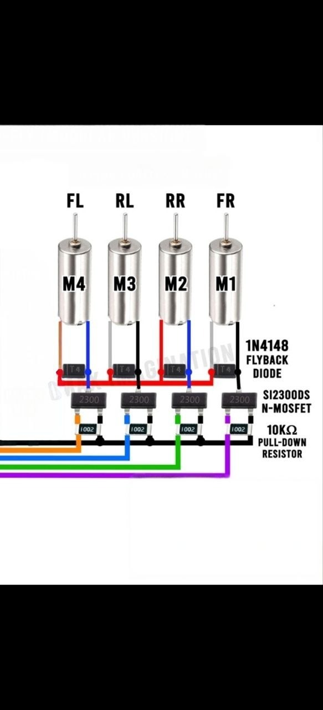
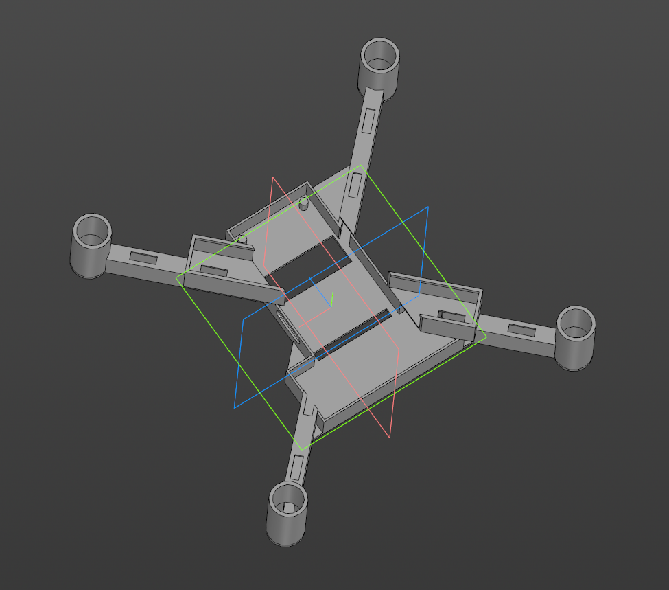

# ESP32-S3 Gamepad Drone

A DIY brushed-motor quadcopter flight controller for the **ESP32-S3 Super Mini**, piloted by an **Xbox One S controller** over Bluetooth. Stabilization architecture is ported from Espressif's [esp-drone](https://github.com/espressif/esp-drone) firmware (Mahony AHRS + cascaded angle/rate PID + X-frame mixer), adapted to run on top of a **hand-built low-side N-MOSFET driver board** instead of the ESCs used on brushless quads.


## Status

**Flying.** Verified takeoff, hover under pilot control, controlled landing on a homemade 3D-printed frame with 6×15 mm coreless motors on a 1S LiPo (~1.2 Wh, ~335 mAh).

PID gains are conservative defaults — they get the drone off the ground and controllable, but are not tuned to any specific frame or weight. Expect to hand-tune on your own hardware.

## Hardware

| Part | Role |
|---|---|
| **Seeed / generic ESP32-S3 Super Mini** | Flight controller (2× core, BLE + BT Classic, USB-C) |
| **MPU6050** (GY-521 breakout, clones OK) | 6-axis IMU for attitude estimation |
| **Xbox One S wireless controller** | Pilot input over Bluetooth via [Bluepad32](https://bluepad32.readthedocs.io/) |
| **4× SI2300 N-channel MOSFETs** | One low-side switch per motor, hand-soldered driver board |
| **4× 1N4148 diodes** | Flyback protection across each motor |
| **4× 10 kΩ resistors** | Gate pull-downs on each MOSFET |
| **4× 6×15 mm coreless brushed motors** | Propulsion |
| **1S LiPo battery** (~250–350 mAh) | Power |
| **~36 g** total flying weight | Frame + electronics + battery |

The **DIY MOSFET driver board is a load-bearing custom part** of this build — this is not an off-the-shelf ESC quad. Each of the four motors is switched by a SI2300 N-MOSFET tied to a PWM output on the ESP32. Reference wiring follows the ESP-FLY modular diagram by Max Imagination, which was the electrical starting point for this build.

### Motor driver board

<p align="center">
  
</p>

Four identical channels, one per motor. Each channel: an **SI2300DS** N-MOSFET as a low-side switch, a **1N4148** flyback diode across the motor to clamp inductive kickback when the MOSFET turns off, and a **10 kΩ pull-down** on the gate to guarantee the MOSFET is *off* while the MCU boots or the pin floats. Motor `+` terminal goes to battery `+`; motor `–` terminal goes to the MOSFET drain; MOSFET source goes to battery `–` (common ground). PWM from the ESP32 drives the gate directly (3.3 V logic — SI2300 is a logic-level MOSFET, so no gate driver IC needed).

### Frame

Homemade 3D-printed frame (STEP source in `docs/frame_v4.1.stp`, ~36 g total flying weight with electronics and battery). X-shape, four motor cups for 6 mm coreless motors, central bay for the ESP32 + MPU6050 + MOSFET board stack, and a slot for a 1S LiPo along one arm.

<p align="center">
  
</p>

### System wiring

```
                    ┌──────────────────┐         ┌─────────────────┐
                    │  MPU6050 (GY-521) │         │  Xbox One S     │
                    │                    │         │  controller     │
                    │  VCC───3V3         │         │  (wireless)     │
                    │  GND───GND         │         └────────┬────────┘
                    │  SDA───GP8         │                  │
                    │  SCL───GP9         │                  │ Bluetooth
                    │  INT───GP10 (opt)  │                  │ (Bluepad32)
                    └────────┬───────────┘                  │
                             │ I2C @ 100 kHz                │
                             │                              │
                    ┌────────┴──────────────────────────────┴──────────┐
                    │                                                    │
                    │         ESP32-S3 Super Mini                        │
                    │         (esp32-bluepad32:esp32:esp32s3)            │
                    │                                                    │
                    │   GP1 ─── PWM out ─── FL motor MOSFET gate         │
                    │   GP2 ─── PWM out ─── RL motor MOSFET gate         │
                    │  GP12 ─── PWM out ─── FR motor MOSFET gate         │
                    │  GP13 ─── PWM out ─── RR motor MOSFET gate         │
                    │  GP48 ─── onboard WS2818 (status LED)              │
                    │                                                    │
                    └──────────┬─────┬─────┬─────┬──────────────────────┘
                               │     │     │     │
                               │     │     │     │  4× PWM @ 16 kHz, 10-bit
                               ▼     ▼     ▼     ▼
                       (to the four MOSFET driver channels above)
```

Motor placement (viewed from above, front = X+):

```
         FL ●─────────────● FR
             \           /
              \  ┌─────┐ /
               \ │ ESP │/
                X│  +  │X    ← X-frame
               / │ MPU │\
              /  └─────┘ \
             /           \
         RL ●─────────────● RR
```

Rotation (viewed from above): **FL: CCW ↺, FR: CW ↻, RL: CW ↻, RR: CCW ↺** — diagonals spin the same direction, adjacent motors spin opposite, so their reaction torques cancel.

### Motor pin assignment rationale

- **GP1 / GP2** on the left side of the board and **GP12 / GP13** on the right side keep motor cables physically separated by side, which reduces crossovers over the flight controller.
- **GP8 / GP9** are the ESP32-S3 Arduino Core default I²C pins, used for the MPU6050.
- **GP10** carries the MPU6050 `INT` line — data-ready diagnostic only. The main control loop runs on polling.
- **GP48** is hard-wired on the Super Mini board to an onboard WS2818 addressable RGB LED — used as a status indicator (red = no IMU, blue = disarmed, green = armed).
- **GP3 – GP7** and **GP14 – GP16** are left free for a future battery voltage divider (ADC1).

## Firmware architecture

Ported from the structure of Espressif's [esp-drone](https://github.com/espressif/esp-drone) (a Crazyflie-derivative flight stack for the ESP32), *not* copied gain-for-gain — the numbers in `esp-drone/pid.h` are calibrated for a brushless Crazyflie-class craft driving 0–65535-scale ESCs, which would be dangerous on our low-thrust brushed motors. What was ported:

| Component | Source (esp-drone) | Our file |
|---|---|---|
| **Mahony AHRS** (quaternion sensor fusion) | `components/core/crazyflie/modules/src/sensfusion6.c` (MAHONY_QUATERNION_IMU branch) | `ImuManager.cpp::mahonyUpdate()` |
| **Generic PID object** (P + I + D, iLimit, outputLimit) | `pid.c` / `pid.h` | `PidController` in `StabilizationController.h` |
| **Angle → rate cascade** (outer PID: measured angle → desired rate; inner PID: measured gyro rate → motor output) | `attitude_pid_controller.c` + `controller_pid.c` | `StabilizationController::compute()` |
| **Yaw heading hold** (stick integrates into target yaw with `capAngle` wrap, not direct rate control — drone holds heading when stick is released) | `controller_pid.c` (`modeVelocity` for yaw) | Same |
| **Zero-thrust reset** (at throttle = 0: force all motors to 0, reset all 6 PIDs, resync yaw target to current heading) | `controller_pid.c`, `if (control->thrust == 0)` block | Same |
| **X-frame mixer** (`r = roll/2`, `p = pitch/2`, `m = thrust ± r ± p ± yaw`) | `power_distribution_stock.c` | `StabilizationController::compute()` tail |

Deliberately **not** ported (not relevant for this hardware): position controller (requires baro / flow deck), Kalman estimator, CRTP radio commander, propeller self-test, brushless thrust-curve compensation.

Deliberately **different** from esp-drone: `IDLE_THRUST = 0` (esp-drone spins motors at a low idle whenever armed, needed for brushless ESC response time — for our brushed motors it's neither needed nor safer).

## File layout

```
ESP32_S3_Gamepad_Drone/
├── ESP32_S3_Gamepad_Drone.ino     Top-level orchestrator, control loop, arm/disarm state machine
├── Config.h                         All pin mappings, PID gains, safety thresholds, timings
├── GamepadManager.h/.cpp            Bluepad32 wrapper: normalized stick/trigger/button axes + connection timeout
├── ImuManager.h/.cpp                MPU6050 (with clone-chip fallback) + Mahony AHRS + gyro bias / level trim calibration
├── StabilizationController.h/.cpp   Cascaded angle/rate PID + X-frame mixer, ported from esp-drone
├── MotorManager.h/.cpp              LEDC PWM output on 4 MOSFET gates, disarm safety cutoff
├── StatusIndicator.h/.cpp           Adafruit NeoPixel driver for the onboard WS2818 LED
├── debug.cfg                         OpenOCD config for on-chip JTAG debugging via USB
└── docs/
    ├── frame_v4.1.stp               3D-printable frame (STEP AP203, ~36 g flying weight)
    ├── frame_render.png             Preview of the printable frame
    └── mosfet_wiring.jpg            Reference wiring diagram for the driver board
```

## Controls (Xbox One S)

Layout is FPS-style (movement on left stick, camera / rotation on right), not classic RC Mode 2:

| Control | Function |
|---|---|
| **RT (right trigger)** | Throttle, 0–100%. Trigger is non-self-centering, so releasing = 0% — safer than a stick for absolute throttle. |
| **Left stick Y** (up/down) | Pitch — nose forward / backward |
| **Left stick X** (left/right) | Roll — translate left / right |
| **Right stick X** (left/right) | Yaw — rotate about vertical axis |
| **Right stick Y** | *Unused* |
| **L1 + R1** held ≥ 500 ms with throttle ≈ 0 | **ARM** the drone (motors go live) |
| **B** | **DISARM** immediately — always, from any state |

### Safety features
- Cannot arm without a connected gamepad, initialized IMU, and near-zero throttle.
- **Bluetooth failsafe**: if no packet from the gamepad for `GAMEPAD_TIMEOUT_MS` (300 ms), motors are cut and state returns to disarmed.
- **Zero-throttle latch**: while armed, throttle = 0 forces all motors to 0, resets PID integrators, and re-syncs yaw target — no idle spin.
- **I²C timeout** (`Wire.setTimeOut(50 ms)`): a bad SDA/SCL contact mid-transaction can't lock the control loop forever.
- **Auto-recalibration on disarm**: gyro bias + level trim re-captured after each landing, with a variance-based "wait for still" gate that rejects noisy samples (rare motor spin-down vibration is not mistaken for the new zero).

## Build & flash

Requires the **Bluepad32 fork of the Arduino ESP32 core** (`esp32-bluepad32:esp32`), *not* the vanilla `esp32:esp32` core — Bluepad32 needs its own bootloader partition to boot the BT classic stack.

Libraries (all installable from the Arduino Library Manager):
- Adafruit MPU6050 + Adafruit BusIO + Adafruit Unified Sensor
- Adafruit NeoPixel

Compile & flash via `arduino-cli`:

```bash
arduino-cli compile --fqbn "esp32-bluepad32:esp32:esp32s3:CDCOnBoot=cdc" ESP32_S3_Gamepad_Drone
arduino-cli upload  -p COMx --fqbn "esp32-bluepad32:esp32:esp32s3:CDCOnBoot=cdc" ESP32_S3_Gamepad_Drone
```

**`CDCOnBoot=cdc` is mandatory** — with the default value `Serial` output goes to the physical UART0 pins (which are not wired), not to the USB port, and the Serial Monitor stays silent even though the flash succeeded.

Open Serial Monitor at **115 200 baud**. In test mode (disarmed + gamepad connected), the firmware prints a live labeled dump of every stick / trigger / button state every 250 ms, so you can verify your control mapping against reality before ever arming.

## Bring-up checklist

Do this in order on a **new build**, with **props off**:

1. **Power on, USB Serial Monitor open.** Confirm you see either `MPU6050 OK (Adafruit)` or `MPU6050: Adafruit library refused ... falling back to raw Wire`. Both are fine; the clone-chip fallback is common on cheap GY-521 modules where `WHO_AM_I = 0x70` (MPU6500 clone) instead of `0x68`.
2. **Wait for `Calibration complete`.** Do not move the drone during this ~2-second window.
3. **Pair the gamepad.** Serial Monitor should log `Gamepad connected, slot=0, model=XBox One`.
4. **Verify controls** in test mode (still disarmed): push every stick / trigger / button; the Serial dump should print `L-Y=+1.00 (ВПЕРЕД)` (front), etc. If a direction is mirrored, invert the sign in `GamepadManager.cpp` before arming.
5. **Bench-test motor direction** (still no props): hold L1+R1 to arm, apply small throttle, verify each motor spins in the direction shown in the diagram above (FL/RR one way, FR/RL the other). Brushed motor direction is set by wiring polarity — swap the two motor wires on any motor that spins the wrong way. **Do not fix this in software.**
6. **Bench-test stabilization signs** (still no props): with the drone armed and gently throttled, tilt it by hand in each axis. The corresponding side of motors should *speed up* to push the drone back to level. If a tilt causes the wrong side to speed up (drone would flip further), invert the sign of the corresponding output in `StabilizationController::compute()`.
7. **Only then** attach props and attempt a hover.

## Known limitations

- **No battery voltage monitoring yet** — ADC pin (GP4 recommended) and a 10k/10k divider are wired for in the pin plan, but no code for it. Watch flight time manually or fly with a low-voltage buzzer.
- **PID gains are seed values.** They fly this specific 36 g build tolerably; a heavier / lighter / differently-balanced frame will need retuning. Start with `PID_ROLL_KP` / `PID_PITCH_KP` in `Config.h`.
- **Yaw drifts slowly** — no magnetometer, so yaw is pure gyro integration and accumulates ~1°/s of drift. Yaw is heading-hold (stick releases lock in a target), which masks it during flight but the "target" itself creeps.

## License

MIT — see [LICENSE](LICENSE).

The Mahony AHRS math ported from esp-drone traces back to Bitcraze's Crazyflie firmware (originally GPL-3.0 when Bitcraze released it). The math is standard published AHRS work by Sebastian Madgwick and Robert Mahony; this project's clean-room re-implementation for a different hardware target is released under MIT.

## Credits

- **Espressif** — [esp-drone](https://github.com/espressif/esp-drone) architecture reference.
- **Bitcraze AB** — the original Crazyflie firmware, from which esp-drone descends.
- **Ricardo Quesada** — [Bluepad32](https://github.com/ricardoquesada/bluepad32), which does the heavy lifting of pairing an Xbox controller to an ESP32.
- **Max Imagination** — the modular ESP-FLY wiring diagram that this build's driver board followed.
- **Sebastian Madgwick** and **Robert Mahony** — the published quaternion AHRS algorithms.
