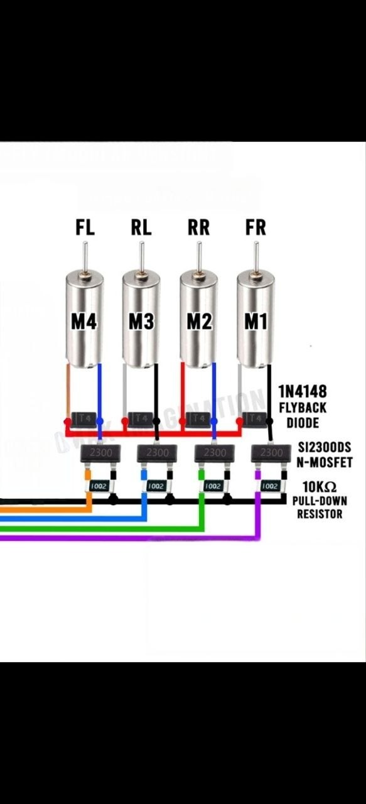
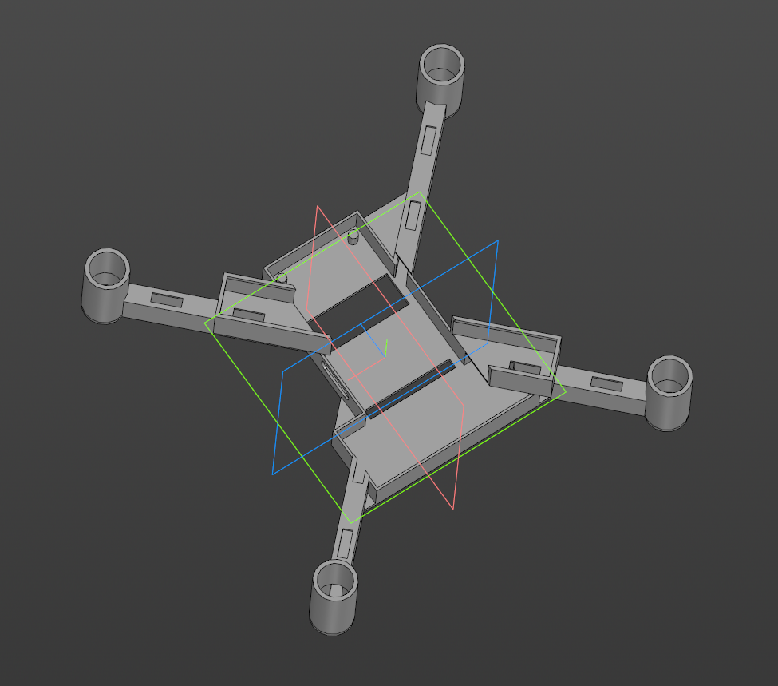

# ESP32-S3 Gamepad Drone

[English](README.md) | **Українська**

Саморобний польотний контролер квадрокоптера з колекторними моторами на **ESP32-S3 Super Mini**,
керування **геймпадом Xbox One S** по Bluetooth. Архітектуру стабілізації перенесено з прошивки
Espressif [esp-drone](https://github.com/espressif/esp-drone) (Mahony AHRS + каскадний PID кут/швидкість
+ мікшер X-рами) і пристосовано під **саморобну плату ключів на N-MOSFET у нижньому плечі** замість
регуляторів (ESC), як на безколекторних квадриках.


## Стан

**Літає.** Перевірено зліт, зависання під керуванням пілота й керовану посадку на саморобній
3D-друкованій рамі з безсердечниковими моторами 6×15 мм від 1S LiPo (~1.2 Вт·год, ~335 мА·год).

Коефіцієнти PID — обережні стартові значення: дрон з ними злітає й керується, але під конкретну
раму чи вагу вони не налаштовані. На своєму залізі готуйтеся підбирати їх вручну.

## Залізо

| Компонент | Роль |
|---|---|
| **Seeed / звичайний ESP32-S3 Super Mini** | Польотний контролер (2 ядра, BLE + BT Classic, USB-C) |
| **MPU6050** (модуль GY-521, клони підходять) | 6-осьовий IMU для оцінки положення |
| **Бездротовий геймпад Xbox One S** | Керування по Bluetooth через [Bluepad32](https://bluepad32.readthedocs.io/) |
| **4× N-канальні MOSFET SI2300** | Ключ у нижньому плечі на кожен мотор, плата спаяна вручну |
| **4× діоди 1N4148** | Захист від зворотного викиду на кожному моторі |
| **4× резистори 10 кОм** | Стягування затвора кожного MOSFET до землі |
| **4× безсердечникові колекторні мотори 6×15 мм** | Тяга |
| **Акумулятор 1S LiPo** (~250–350 мА·год) | Живлення |
| **~36 г** злітна вага | Рама + електроніка + акумулятор |

**Саморобна плата ключів на MOSFET — несуча частина** цієї збірки: це не квадрик на готових ESC.
Кожен із чотирьох моторів комутує N-MOSFET SI2300, підключений до ШІМ-виходу ESP32. Схема
підключення взята з модульної схеми ESP-FLY від Max Imagination — з неї почалася електрика цієї збірки.

### Плата драйвера моторів

<p align="center">
  
</p>

Чотири однакові канали, по одному на мотор. У кожному каналі: N-MOSFET **SI2300DS** як ключ у
нижньому плечі, діод **1N4148** паралельно мотору, щоб гасити індуктивний викид, коли MOSFET
закривається, і **стягувальний резистор 10 кОм** на затворі, щоб MOSFET гарантовано був *закритий*,
поки МК завантажується або пін висить у повітрі. Вивід мотора `+` — на `+` акумулятора; вивід
мотора `–` — на стік MOSFET; витік MOSFET — на `–` акумулятора (спільна земля). ШІМ з ESP32 іде на
затвор напряму (логіка 3.3 В — SI2300 відкривається логічним рівнем, окремий драйвер затвора не потрібен).

### Рама

Саморобна 3D-друкована рама (вихідник STEP — `docs/frame_v4.1.stp`, ~36 г злітної ваги з
електронікою й акумулятором). X-подібна, чотири гнізда під мотори 6 мм, центральний відсік під
стос ESP32 + MPU6050 + плата ключів і паз під 1S LiPo вздовж одного променя.

<p align="center">
  
</p>

### Загальна схема підключення

```
                    ┌──────────────────┐         ┌─────────────────┐
                    │  MPU6050 (GY-521) │         │  Xbox One S     │
                    │                    │         │  геймпад        │
                    │  VCC───3V3         │         │  (бездротовий)  │
                    │  GND───GND         │         └────────┬────────┘
                    │  SDA───GP8         │                  │
                    │  SCL───GP9         │                  │ Bluetooth
                    │  INT───GP10 (необ.)│                  │ (Bluepad32)
                    └────────┬───────────┘                  │
                             │ I2C @ 100 кГц                │
                             │                              │
                    ┌────────┴──────────────────────────────┴──────────┐
                    │                                                    │
                    │         ESP32-S3 Super Mini                        │
                    │         (esp32-bluepad32:esp32:esp32s3)            │
                    │                                                    │
                    │   GP1 ─── ШІМ ─── затвор MOSFET мотора FL          │
                    │   GP2 ─── ШІМ ─── затвор MOSFET мотора RL          │
                    │  GP12 ─── ШІМ ─── затвор MOSFET мотора FR          │
                    │  GP13 ─── ШІМ ─── затвор MOSFET мотора RR          │
                    │  GP48 ─── вбудований WS2818 (світлодіод стану)     │
                    │                                                    │
                    └──────────┬─────┬─────┬─────┬──────────────────────┘
                               │     │     │     │
                               │     │     │     │  4× ШІМ @ 16 кГц, 10 біт
                               ▼     ▼     ▼     ▼
                       (на чотири канали плати ключів вище)
```

Розташування моторів (вигляд згори, перед = X+):

```
         FL ●─────────────● FR
             \           /
              \  ┌─────┐ /
               \ │ ESP │/
                X│  +  │X    ← X-рама
               / │ MPU │\
              /  └─────┘ \
             /           \
         RL ●─────────────● RR
```

Обертання (вигляд згори): **FL: проти годинникової ↺, FR: за годинниковою ↻, RL: за годинниковою ↻,
RR: проти годинникової ↺** — діагональні мотори крутяться в один бік, сусідні — у протилежні, тож
їхні реактивні моменти компенсуються.

### Чому мотори на цих пінах

- **GP1 / GP2** з лівого боку плати й **GP12 / GP13** з правого розводять дроти моторів по боках —
  менше перехрещень над польотним контролером.
- **GP8 / GP9** — типові піни I²C в Arduino Core для ESP32-S3, на них MPU6050.
- **GP10** — лінія `INT` MPU6050, лише для діагностики готовності даних. Основний цикл керування
  працює опитуванням.
- **GP48** на платі Super Mini жорстко з'єднаний із вбудованим адресним RGB-світлодіодом WS2818 —
  він показує стан (червоний = немає IMU, синій = не взведено, зелений = взведено).
- **GP3 – GP7** і **GP14 – GP16** лишено вільними під майбутній дільник напруги акумулятора (ADC1).

## Архітектура прошивки

Перенесено зі структури Espressif [esp-drone](https://github.com/espressif/esp-drone) (польотний стек
для ESP32, похідний від Crazyflie), але *не* скопійовано коефіцієнт у коефіцієнт: числа в
`esp-drone/pid.h` відкалібровані під безколекторний апарат класу Crazyflie з ESC у шкалі 0–65535 і
були б небезпечні на наших слабких колекторних моторах. Що перенесено:

| Компонент | Джерело (esp-drone) | Наш файл |
|---|---|---|
| **Mahony AHRS** (злиття датчиків через кватерніон) | `components/core/crazyflie/modules/src/sensfusion6.c` (гілка MAHONY_QUATERNION_IMU) | `ImuManager.cpp::mahonyUpdate()` |
| **Загальний об'єкт PID** (P + I + D, iLimit, outputLimit) | `pid.c` / `pid.h` | `PidController` у `StabilizationController.h` |
| **Каскад кут → швидкість** (зовнішній PID: виміряний кут → бажана швидкість; внутрішній PID: виміряна швидкість гіроскопа → вихід на мотори) | `attitude_pid_controller.c` + `controller_pid.c` | `StabilizationController::compute()` |
| **Утримання курсу по рисканню** (стік інтегрується в цільовий курс із загортанням `capAngle`, а не пряме керування швидкістю — відпустив стік, і дрон тримає курс) | `controller_pid.c` (`modeVelocity` для yaw) | Там само |
| **Скидання на нульовому газі** (газ = 0: усі мотори в 0, скинути всі 6 PID, підтягнути цільовий курс до поточного) | `controller_pid.c`, блок `if (control->thrust == 0)` | Там само |
| **Мікшер X-рами** (`r = roll/2`, `p = pitch/2`, `m = thrust ± r ± p ± yaw`) | `power_distribution_stock.c` | кінець `StabilizationController::compute()` |

Навмисно **не** перенесено (для цього заліза не потрібне): регулятор позиції (потрібен барометр /
датчик оптичного потоку), фільтр Калмана, радіокомандир CRTP, самотест пропелерів, компенсація кривої
тяги безколекторних моторів.

Навмисно **інакше**, ніж у esp-drone: `IDLE_THRUST = 0` (esp-drone крутить мотори на малих
холостих, щойно дрон взведено, — це потрібно для швидкого відгуку безколекторних ESC; нашим
колекторним моторам це не потрібно й безпечнішим не робить).

## Файли

```
ESP32_S3_Gamepad_Drone/
├── ESP32_S3_Gamepad_Drone.ino     Головний модуль, цикл керування, автомат взведення/зняття
├── Config.h                         Усі піни, коефіцієнти PID, пороги безпеки, таймінги
├── GamepadManager.h/.cpp            Обгортка Bluepad32: нормовані осі стіків/курків/кнопок + тайм-аут зв'язку
├── ImuManager.h/.cpp                MPU6050 (із запасним шляхом для клонів) + Mahony AHRS + калібрування зміщення гіроскопа й горизонту
├── StabilizationController.h/.cpp   Каскадний PID кут/швидкість + мікшер X-рами, перенесено з esp-drone
├── MotorManager.h/.cpp              ШІМ LEDC на 4 затвори MOSFET, аварійне вимкнення при знятті
├── StatusIndicator.h/.cpp           Драйвер Adafruit NeoPixel для вбудованого WS2818
├── debug.cfg                         Конфіг OpenOCD для налагодження по JTAG через USB
└── docs/
    ├── frame_v4.1.stp               Рама для 3D-друку (STEP AP203, ~36 г злітної ваги)
    ├── frame_render.png             Прев'ю рами для друку
    └── mosfet_wiring.jpg            Схема підключення плати ключів
```

## Керування (Xbox One S)

Розкладка як у шутерах (рух — лівий стік, камера / поворот — правий), а не класичний RC Mode 2:

| Елемент | Функція |
|---|---|
| **RT (правий курок)** | Газ 0–100%. Курок не повертається в центр, тож відпустив = 0% — безпечніше за стік для абсолютного газу. |
| **Лівий стік Y** (вгору/вниз) | Тангаж — ніс уперед / назад |
| **Лівий стік X** (вліво/вправо) | Крен — зміщення вліво / вправо |
| **Правий стік X** (вліво/вправо) | Рискання — поворот навколо вертикальної осі |
| **Правий стік Y** | *Не використовується* |
| **L1 + R1** утримувати ≥ 500 мс при газі ≈ 0 | **ВЗВЕСТИ** дрон (мотори під напругою) |
| **B** | **ЗНЯТИ** негайно — завжди, з будь-якого стану |

### Безпека
- Не можна взвести без під'єднаного геймпада, ініціалізованого IMU і газу біля нуля.
- **Аварійний режим при втраті Bluetooth**: якщо від геймпада немає пакета `GAMEPAD_TIMEOUT_MS`
  (300 мс), мотори вимикаються й стан повертається в «не взведено».
- **Фіксація нульового газу**: коли взведено, газ = 0 ставить усі мотори в 0, скидає інтегратори PID
  і підтягує цільовий курс — жодного холостого обертання.
- **Тайм-аут I²C** (`Wire.setTimeOut(50 ms)`): поганий контакт SDA/SCL посеред обміну не повісить
  цикл керування назавжди.
- **Автокалібрування при знятті**: зміщення гіроскопа й горизонт перезнімаються після кожної посадки,
  з воротами «зачекати, поки нерухомо» за дисперсією, які відкидають шумні вибірки (вібрацію моторів,
  що зупиняються, не буде прийнято за новий нуль).

## Збірка й прошивка

Потрібен **форк Arduino ESP32 core від Bluepad32** (`esp32-bluepad32:esp32`), *а не* звичайне ядро
`esp32:esp32` — Bluepad32 потребує власного розділу завантажувача, щоб запустити стек BT Classic.

Бібліотеки (усі ставляться з Arduino Library Manager):
- Adafruit MPU6050 + Adafruit BusIO + Adafruit Unified Sensor
- Adafruit NeoPixel

Збірка й заливка через `arduino-cli`:

```bash
arduino-cli compile --fqbn "esp32-bluepad32:esp32:esp32s3:CDCOnBoot=cdc" ESP32_S3_Gamepad_Drone
arduino-cli upload  -p COMx --fqbn "esp32-bluepad32:esp32:esp32s3:CDCOnBoot=cdc" ESP32_S3_Gamepad_Drone
```

**`CDCOnBoot=cdc` обов'язковий** — зі значенням за замовчуванням вивід `Serial` іде на фізичні
піни UART0 (вони не підключені), а не в USB-порт, і монітор порту мовчить, хоч заливка пройшла успішно.

Відкрийте монітор порту на **115 200 бод**. У тестовому режимі (не взведено + геймпад під'єднано)
прошивка кожні 250 мс друкує підписаний стан кожного стіка / курка / кнопки — так можна звірити
розкладку з реальністю ще до взведення.

## Перший запуск — чек-лист

Робіть по порядку на **новій збірці**, **без пропелерів**:

1. **Увімкніть живлення, відкрийте монітор порту по USB.** Має бути або `MPU6050 OK (Adafruit)`,
   або `MPU6050: Adafruit library refused ... falling back to raw Wire`. Обидва варіанти нормальні;
   запасний шлях для клонів часто потрібен на дешевих GY-521, де `WHO_AM_I = 0x70` (клон MPU6500), а не `0x68`.
2. **Дочекайтеся `Calibration complete`.** Не рухайте дрон у ці ~2 секунди.
3. **Під'єднайте геймпад.** У моніторі має з'явитися `Gamepad connected, slot=0, model=XBox One`.
4. **Перевірте керування** в тестовому режимі (ще не взведено): поворушіть кожен стік / курок /
   кнопку; у виводі має бути `L-Y=+1.00 (ВПЕРЕД)` тощо. Якщо напрямок дзеркальний — змініть знак у
   `GamepadManager.cpp` до взведення.
5. **Перевірте напрямок моторів на столі** (ще без пропелерів): затисніть L1+R1, щоб взвести, дайте
   трохи газу й переконайтеся, що кожен мотор крутиться як на схемі вище (FL/RR в один бік, FR/RL в
   інший). Напрямок колекторного мотора задає полярність — на моторі, що крутиться не туди, поміняйте
   місцями два дроти. **Не виправляйте це програмно.**
6. **Перевірте знаки стабілізації на столі** (ще без пропелерів): взведіть дрон, дайте трохи газу й
   нахиліть його рукою по кожній осі. Мотори з відповідного боку мають *прискоритися*, щоб повернути
   дрон у горизонт. Якщо прискорюється не той бік (дрон перевертався б далі), змініть знак відповідного
   виходу в `StabilizationController::compute()`.
7. **Лише тоді** ставте пропелери й пробуйте зависання.

## Відомі обмеження

- **Напруга акумулятора ще не вимірюється** — пін ADC (рекомендовано GP4) і дільник 10k/10k
  передбачено в плані пінів, але коду немає. Стежте за часом польоту вручну або літайте з пищалкою
  низької напруги.
- **Коефіцієнти PID — стартові.** Ця конкретна збірка на 36 г з ними літає стерпно; важча / легша /
  інакше збалансована рама потребуватиме налаштування. Почніть із `PID_ROLL_KP` / `PID_PITCH_KP` у `Config.h`.
- **Курс повільно дрейфує** — магнітометра немає, рискання — чисте інтегрування гіроскопа й набігає
  ~1°/с. Рискання працює як утримання курсу (відпущений стік фіксує ціль), що маскує дрейф у польоті,
  але сама «ціль» повзе.

## Ліцензія

MIT — див. [LICENSE](LICENSE).

Математика Mahony AHRS, перенесена з esp-drone, походить із прошивки Crazyflie від Bitcraze
(Bitcraze випустили її під GPL-3.0). Сама математика — стандартна опублікована робота з AHRS Себастьяна
Маджвіка й Роберта Махоні; незалежна реалізація цього проєкту під інше залізо випущена під MIT.

## Подяки

- **Espressif** — [esp-drone](https://github.com/espressif/esp-drone), взірець архітектури.
- **Bitcraze AB** — оригінальна прошивка Crazyflie, від якої походить esp-drone.
- **Ricardo Quesada** — [Bluepad32](https://github.com/ricardoquesada/bluepad32), що бере на себе
  всю важку роботу зі спарювання геймпада Xbox з ESP32.
- **Max Imagination** — модульна схема ESP-FLY, за якою зроблено плату ключів цієї збірки.
- **Себастьян Маджвік** і **Роберт Махоні** — опубліковані кватерніонні алгоритми AHRS.
